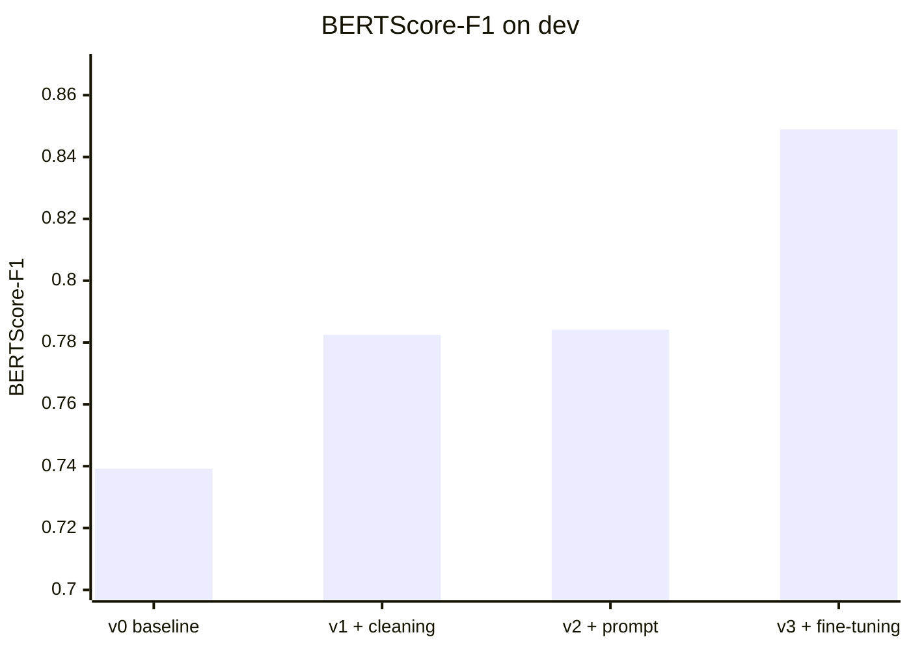

# Task 6: Multilingual and Multimodal Culturally-Grounded Spoken and Visual Question Answering

University project for **SemEval-2027 Task 6 (MMCultureQA)**, sub-task **Task 2: Textual VQA**.
Track: `qa_mena_en` (MENA region, English questions and answers).

The model gets an image and a free-text question about it and must produce a short free-text answer
grounded in the cultural context of the image. Answers are scored with BERTScore against a reference answer.

## Summary of findings so far

| Variant | Eval set | BERTScore-F1 | P | R | ROUGE-L | BLEU |
|---|---|---|---|---|---|---|
| v0: zero-shot baseline (Qwen2.5-Omni-3B) | dev, 1000 | 0.7392 | 0.6908 | 0.7974 | 0.2510 | 9.68 |
| v1: v0 + answer post-processing | dev, 1000 | 0.7825 | 0.7736 | 0.7945 | 0.3356 | 15.09 |
| v2: new prompt + post-processing | dev, first 300 | 0.7841 | 0.7648 | 0.8075 | 0.3308 | – |
| **v3: QLoRA fine-tuned (2000 train items, 1 epoch)** | dev, first 300 | **0.8489** | **0.8596** | **0.8402** | **0.4840** | **28.25** |

All variants have coverage 1.0. Two independent fine-tuning runs (the second resumed from the step-100 checkpoint)
gave almost identical v3 scores (F1 0.8488 and 0.8489), so the result is reproducible.

Key observations:

- **Post-processing alone gives about +0.04 F1** (v0 to v1). The base model often keeps talking after the answer:
  it appends `Human:` turns, asks follow-up questions, or stops mid-sentence. Cutting these off mainly raises precision.
- **The new prompt alone adds almost nothing** (v1 to v2, +0.002, on a different subset, so not directly comparable).
- **Fine-tuning gives a clear gain of +0.065 F1 over v2** on the same 300 dev questions. With 300 items the
  sampling noise is roughly ±0.005, so this is far outside noise.
- **Much of the gain comes from matching the answer style.** Precision jumps from 0.76 to 0.86 and ROUGE-L from
  0.33 to 0.48. The model learned to answer in one or two factual sentences phrased like the references
  ("The image depicts…"). BERTScore rewards this strongly.
- **Content looks largely correct in spot checks.** Landmarks such as the Burj Khalifa, Carthage and the
  Anti-Lebanon range are identified correctly. Some answers are plausible but generic, for example on the cultural
  meaning of lanterns. BERTScore barely penalises that, so a manual error analysis is still needed.
- The fine-tuned answers tend to be **shorter than the references**. They often omit the extra context sentence
  the gold answers contain ("They are particularly prevalent in…"), which limits recall.

### Caveats

- v0 and v1 were scored on all 1000 dev questions, v2 and v3 only on the **first 300** (generation runs at about
  0.10 items/s on a T4). Only the v2 vs v3 comparison is strictly like-for-like.
- The final number should be confirmed on the full 1000 dev questions (`EVAL_LIMIT = None`, `TRAIN = False`).
- Nothing has been submitted to the leaderboard. Any devtest submission will only happen after a manual check.

## Analysis of the fine-tuned model

The analysis below compares the v3 predictions with the dev reference answers on the same 300 questions.
ROUGE-L and word-overlap F1 were computed with a simple script (lower-cased word tokens), not with the official
scorer. The ROUGE-L value for v3 (0.484) matches the official one.

### Answer length and overlap

| Variant | Mean words per answer | ROUGE-L | Word-overlap F1 |
|---|---|---|---|
| v0 baseline | 50.6 | 0.247 | 0.320 |
| v1 baseline + post-processing | 31.6 | 0.331 | 0.411 |
| **v3 fine-tuned** | **23.1** | **0.484** | **0.556** |
| Reference answers | 25.2 | – | – |

- The baseline answers are twice as long as the references. The fine-tuned model almost matches the reference
  length (1.14 vs 1.22 sentences per answer).
- **v3 beats v1 on 253 of 300 questions (84 %)** in ROUGE-L, so the improvement is broad and not driven by a few outliers.

### Results by question type

| Question type | n | ROUGE-L v1 → v3 |
|---|---|---|
| "What …" | 197 | 0.32 → 0.48 |
| "… significance …" | 60 | 0.31 → 0.45 |
| "Where …" | 20 | 0.48 → 0.68 |
| "How …" | 14 | 0.29 → 0.41 |
| "Why …" | 8 | 0.43 → 0.50 |

All question types improve. Questions about **cultural significance** and "how" questions remain the weakest.
Their reference answers require background knowledge that is not visible in the image.

### Generation behaviour

- No empty answers.
- The model stops cleanly after the answer. In 299 of 300 cases generation ends at the `Human:` stop string,
  which `clean_answer` removes. No answer is cut off by the 64-token limit.
- Only 2 answers repeat a sentence.

### Error analysis

We read the 15 answers with the lowest word-overlap F1 by hand and found three error types:

| Error type | Examples |
|---|---|
| **Wrong recognition / hallucination** (most severe) | Souq Waqif: the model names the "Al-Bidda Tower" instead of the spiral minaret of the Fanar Islamic Cultural Center. A horse-riding stunt show is called "Buzkashi". A cosplay panel is described as a "press conference". |
| **Too generic** | Mosaic: "part of a historical or religious building" instead of the paradise symbolism of Islamic art. Protest signs: "justice, freedom, change" instead of opposition to foreign interference in Libya. |
| **Correct but phrased differently** | Syrian opposition flags, port explosion, flute, currency exchange: correct in content, but shorter or worded differently from the reference. |

**Conclusion:** Fine-tuning mainly improved the **form and style** of the answers (length, structure,
phrasing). It added little **cultural knowledge**, which is expected with 2000 examples and a 3B model.
Part of the low-scoring answers are actually correct, which shows a limitation of the overlap-based metrics
rather than of the model.

## Data

Dataset: [`QCRI/MMCQA-SemEval27`](https://huggingface.co/datasets/QCRI/MMCQA-SemEval27), config `qa_mena_en`.

| Split | Items | Answers | Use in this project |
|---|---|---|---|
| train | 10,000 | yes | fine-tuning (2000 items) and validation (200 items) |
| dev | 1,000 | yes | evaluation only |
| devtest | – | no | official leaderboard (EvalAI), not used yet |
| test | – | no | released January 2027 |

The model is **trained only on `train` and evaluated on `dev`**, so there is no train/test leakage. The 200
validation items are split off from `train` (shuffle with seed 42). The notebook checks that train, validation
and dev do not overlap.

## Evaluation

Official scorer from [mmcultureqa-semeval27/mmcultureqa](https://github.com/mmcultureqa-semeval27/mmcultureqa)
(`scorer/score.py`):

- BERTScore-F1 (main metric) with `jhu-clsp/mmBERT-base`, revision `c5955035435e`, layer 17, no IDF, no rescaling
- also BERTScore P/R, BLEU (flores200 tokenizer) and ROUGE-L

The notebooks clone the scorer and run it unchanged.

## Where the improvement comes from

Overall, BERTScore-F1 rises by about **+0.11**, from 0.739 (baseline) to 0.849 (fine-tuned). The gain comes from
two sources: cleaning up the answers (+0.04) and fine-tuning (+0.065).

| Step | Eval set (dev questions) | BERTScore-F1 | Gain | Source of the gain |
|---|---|---|---|---|
| v0: baseline | 1000 | 0.7392 | – | starting point (zero-shot Qwen2.5-Omni-3B) |
| v1: + post-processing | 1000 | 0.7825 | **+0.043** | `clean_answer` removes invented `Human:` turns, follow-up questions and cut-off sentences |
| v2: + new prompt | 300 | 0.7841 | +0.002 | almost no effect |
| v3: + QLoRA fine-tuning | 300 | **0.8489** | **+0.065** | training on 2000 train items |
| **Total** | | | **≈ +0.11** | |

**How to read this:**

- About 40 % of the total gain needs **no training at all**. It comes from removing the text the base model
  keeps generating after the actual answer.
- About 60 % of the gain comes from **fine-tuning**, which teaches the model the short, factual answer style of
  the references.
- Only the step **v2 → v3 (+0.065) is an exact like-for-like comparison**, because both are scored on the same
  300 dev questions. v0 and v1 were scored on all 1000 questions, so the total of +0.11 compares slightly
  different question sets. Evaluating v2 and v3 on all 1000 questions (see [Next steps](#next-steps)) will give
  the exact total.

## Method

### Base model

`Qwen/Qwen2.5-Omni-3B` (thinker part only, `Qwen2_5OmniThinkerForConditionalGeneration`), images limited to
`512 * 28 * 28` pixels, greedy decoding, max. 64 new tokens.

### Answer post-processing (`clean_answer`)

- cut everything after `Human:` / `User:` (the model simulating the next turn)
- drop follow-up questions back to the user
- drop a truncated last sentence
- strip filler phrases

Generation additionally uses `stop_strings=["Human:", "\nUser:"]`.

### QLoRA fine-tuning

| Setting | Value |
|---|---|
| Quantisation | 4-bit NF4, fp16 compute (T4 has no bf16) |
| LoRA | r = 16, alpha = 32, dropout 0.05 |
| Target modules | `q/k/v/o_proj` and `gate/up/down_proj` of all LLM layers (252 modules, vision encoder frozen) |
| Data | 2000 train items, 200 validation items, 1 epoch |
| Batch | 1 × gradient accumulation 8 (250 optimizer steps) |
| LR | 1e-4, linear warmup and decay |
| Max sequence length | 1280 tokens |
| Loss | only on answer tokens (prompt and image tokens masked) |
| Other | gradient checkpointing, autocast + GradScaler |

The training loop is custom (no `Trainer`). Every 50 steps it saves the adapter plus optimizer, scheduler,
scaler and RNG state, so a run can be resumed deterministically after a disconnect.

| Step | 0 | 50 | 100 | 150 | 200 | 250 |
|---|---|---|---|---|---|---|
| Validation loss | 1.484 | 0.987 | 0.959 | 0.945 | 0.937 | 0.930 |

Most of the improvement happens in the first 50 steps; afterwards validation loss still decreases slowly, with
no sign of overfitting. One optimizer step takes about 1 minute on a T4 (about 4.5 h for 250 steps).

## Repository layout

| File | Content |
|---|---|
| `baseline_qwen_omni.py` | zero-shot baseline (CUDA) |
| `baseline_qwen_omni_mps.py` | baseline variant for Apple Silicon (MPS) |
| `finetune_qlora_colab.ipynb` | full pipeline for Google Colab (data, cleaning, QLoRA training, evaluation), Google Drive storage |
| `finetune_qlora_kaggle.ipynb` | same pipeline for Kaggle; resumes from a checkpoint attached as a Kaggle dataset |
| `results/prediction_qa_en_full.jsonl` | v0 baseline predictions on dev (1000 items) |
| `results/scores_v0.json` | official scores of v0 |
| `models/qlora_r16_n2000/adapter_final/` | trained LoRA adapter (weights not in git, see `.gitignore`) |
| `results/qlora_r16_n2000/` | final fine-tuning run: scores, dev predictions (raw and cleaned), loss history, adapter config |
| `requirements.txt` | dependencies for the baseline scripts |

Notebook comments and descriptions are in Spanish.

## Running the notebooks

By default both notebooks **do not train**. They load the trained LoRA adapter
`models/qlora_r16_n2000/adapter_final/` and only evaluate it (`TRAIN = False`). The adapter file (~120 MB) is not
in git, so it has to be made available to the notebook once:

**Colab:**

1. Upload the project folder `models/` to `MyDrive/mmcqa/` in Google Drive, so that
   `MyDrive/mmcqa/models/qlora_r16_n2000/adapter_final/adapter_model.safetensors` exists.
2. Upload `finetune_qlora_colab.ipynb`, select a T4 GPU, and run all cells. The runtime restarts once after
   installing packages; then run all again.
3. Results are written to `MyDrive/mmcqa_finetune/<run>/`.

**Kaggle:**

1. Import `finetune_qlora_kaggle.ipynb`, then set *Accelerator: GPU T4* and *Internet: On* (needs a verified account).
2. *Add Input*: a Kaggle dataset containing the project folder `models/`, or the output of a previous run of the
   notebook. Cell 2 finds `adapter_final` automatically under `/kaggle/input`.
3. Use **Save Version → Save & Run All (Commit)**. Only a commit keeps `/kaggle/working` after the run.
   Files from an interactive session are deleted when the session ends.
4. Download the output, e.g. `kaggle kernels output <user>/<notebook> -p <dir>`.

**Training a new adapter:** set `TRAIN = True` (first with `SMOKE_TEST = True` for a short test). On Kaggle, an
attached checkpoint (`state.pt`, `adapter_model.safetensors`, `adapter_config.json`) is resumed automatically.
Train images (1.7 GB) are only downloaded when `TRAIN = True`.

Main switches in cell 2:

| Switch | Default | Meaning |
|---|---|---|
| `TRAIN` | `False` | `False`: load the trained adapter and evaluate. `True`: train a new one |
| `ADAPTER_NAME` | `qlora_r16_n2000` | which adapter under `models/` to load |
| `EVAL_LIMIT` | `None` | number of dev questions (`None` = all 1000, about 3 h per variant on a T4) |
| `EVAL_PROMPT_ONLY` | `True` | also evaluate v2 (prompt only, no LoRA) for comparison |
| `SMOKE_TEST` | `False` | short test run with 20 dev questions |

## Lessons learned

- The free Colab GPU quota runs out after a few hours. Save checkpoints often and make the training resumable.
- Downloads of large files (> 100 MB) from Google Drive can silently produce empty files. Always check file sizes.
- On Kaggle, use commits for long runs. An interactive session loses all outputs when it is stopped.
- LoRA adapters (~120 MB) exceed GitHub's 100 MB file limit and are kept out of git (`.gitignore`). The trained
  adapter is stored locally and as Kaggle notebook output.

## Next steps

Ordered by expected value for effort:

1. **Evaluate on the full dev set.** Score v2 and v3 on all 1000 dev questions (`TRAIN = False`,
   `EVAL_LIMIT = None`, `EVAL_PROMPT_ONLY = True`). This takes about 3 h on a Kaggle T4 without training and
   gives the final, like-for-like numbers.
2. **Manual evaluation.** Draw a random sample of about 50 answers and label each one as *correct*, *generic* or
   *wrong*. This measures factual accuracy, which BERTScore and ROUGE-L do not capture, and quantifies the
   error types above.
3. **Train on more data.** Only 2000 of the 10,000 train items are used, and validation loss was still
   decreasing at the end. Training on 5000–10,000 items (about 10–21 h on a T4, resumed across several Kaggle
   runs) should mainly help the knowledge-heavy "significance" questions.
4. **Cheap post-processing fixes.** Remove repeated sentences and test slightly longer answers. The fine-tuned
   answers are a bit shorter than the references and often omit the extra context sentence, which limits recall.
5. **Ablations.** Compare LoRA rank (8 / 16 / 32) and training-set size (500 / 1000 / 2000 / more) to show how
   much data and capacity the gain actually needs.
6. **Leaderboard (devtest).** Only after a manual check: generate devtest predictions and submit them by hand.
   Nothing is uploaded automatically.
